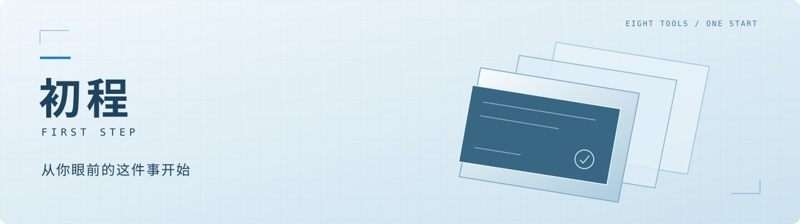
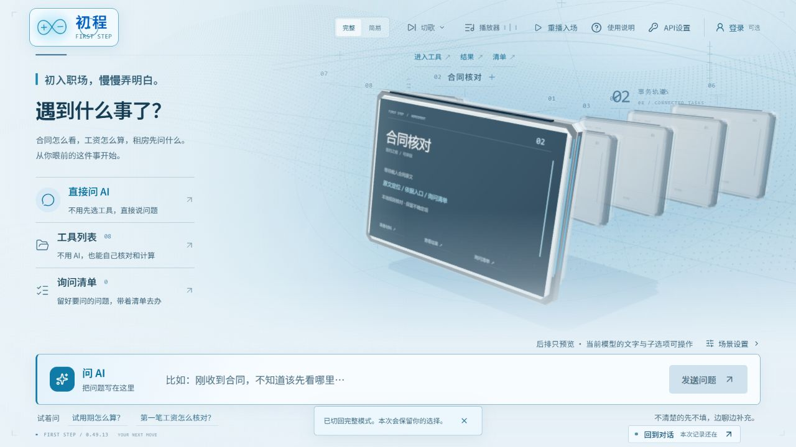
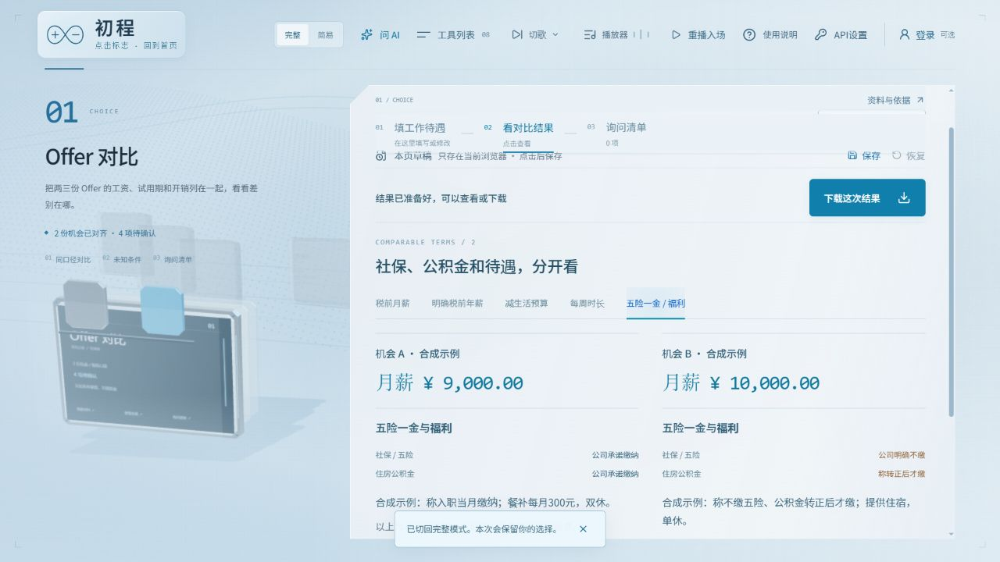
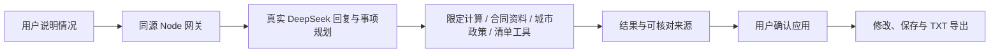

<p align="center"></p>
<p align="center">
<a href="https://github.com/wadwd65/-web-/releases"></a>
<a href="https://github.com/wadwd65/-web-/actions/workflows/ci.yml"></a>


</p>
<p align="center">
<a href="#从一件具体的事开始">项目介绍</a> · <a href="#界面预览">界面预览</a> · <a href="#本地运行">本地运行</a> · <a href="docs/VERSION_HISTORY.md">版本记录</a> · <a href="THIRD_PARTY_NOTICES.md">素材与署名</a>
</p>

# 初程 · First Step

**合同怎么看，工资怎么算，租房先问什么——从你眼前的这件事开始。**

初程是面向初入职场毕业生的桌面 Web 工具。可以直接用自己的话提问，让助手整理已知信息、查找有限的官方资料、调用计算工具；也可以绕过对话，直接使用八项工具。需要继续问 HR、房东或办事窗口的问题，可以带着原文线索加入清单、修改并导出。

第九届传智杯 AI Web 参赛作品，团队名「莱茵生命」。浅蓝银色三维终端是界面表达，音乐是辅助；主线始终是**说明情况 → 核对信息 → 确认结果 → 带走清单**。

> 当前 **v0.49.16**，仍在完善与验收。未提供已验收的公网地址，腾讯云由维护者后续部署。自检不代表比赛评分、专业意见或奖项保证。

## 从一件具体的事开始

- **直接问。** 不必先选类别，也不用照着表格说话。普通问候自然回应，涉及计算、合同或政策时才进入相应核对流程。
- **自己核对。** 必填、选填与补充后才能得到的结论分别标注。未知金额不自动当 0，不完整材料不冒充完整核验。
- **主动确认。** AI 的表单内容和清单需要点击应用才写入；材料不会因为打开页面就自动发送。
- **下次接着看。** 本机主动保存草稿、可选账号与清单，无需强制登录。自建账号服务尚未完成公网恢复和多实例验收。

| 工具 | 作用 | 最少从哪里开始 |
| --- | --- | --- |
| Offer 对比 | 比较月薪、固定月数、预算、五险一金和福利 | 两份税前月薪；福利选填，或粘贴一份待遇说明后确认 |
| 合同核对 | 对照文字定位问题，保留原文和有限官方依据 | 原文与用工类型；图片先人工校对，PDF 仅预览 |
| 工资明细 | 按确认金额核对应发、个人扣款、实发 | 应发即可整理缺项；四项扣款齐全才算实发 |
| 个税指引 | 限定工资薪金范围的年度试算 | 确认收入与扣除；预缴选填，未知时不算退补差额 |
| 社保医保 | 整理办理路线、材料和待确认问题 | 选择事项；地区、险种未知时给基础路线 |
| 租房核对 | 核对文字条款，按已确认费用试算 | 放入原文；费用未齐不生成总额 |
| 城市政策 | 有限已核验资料与官方入口 | 城市和事项；不先强求个人条件，不保证符合资格 |
| 离职转接 | 个人交接、材料和后续询问清单 | 可先生成通用清单；未知情形不套确定通知天数 |

Offer 段落整理是**本机保守规则提取**，需要勾选和确认，不称为 LLM 自动填表。社保、公积金分别记录公司说法，不把福利估值加进工资，不把承诺当实缴证明。

## 界面预览

以下为 v0.49.13 的实际截图，金额与待遇是合成测试数据；首页与工具继续保持这套视觉。v0.49.15—16 在播放器内加入随当前曲目淡入的场景背景，其他页面不随音乐换色。



<details>
<summary>展开查看 Offer 福利对比</summary>



</details>

完整模式保留前景三维子项、抽取与转场、鼠标反馈、入场回放和音乐页；首页切歌就地播放，播放器按钮才进入音乐界面。简易模式卸载重场景，两种模式共用业务、对话与单个音频实例。持续有效低帧可自动降为简易，也可手动选择。

## AI 如何参与



工具计算使用明确输入与规则，模型不能补齐未知金额。合同检索为小范围官方资料；政策仅覆盖广州、深圳的有限补贴及杭州西湖区、上海等有限住宿资料。其他城市的住宿入口从固定官方目录发现并读取正文，**不等于全国政策搜索**。结果保留地区、范围、核验时间与官方链接。

单张 PNG/JPEG 明确发送后识别，先对照原图、编辑确认再填工具。PDF 当前仅预览。模型回复与安全兜底有区分，不把规则提示包装成模型生成。

## 本地运行

需要 **Node.js 24.21 或更新的兼容版本**。从仓库根目录执行：

```bash
npm ci
npm test
npm run build
npm start
```

打开 **http://127.0.0.1:5186/#/home**。端口占用会明确报错，不会悄悄换到旧版本；可用 `PORT` 进程环境变量指定端口。

开发使用 `npm run dev`。Vite 和生产预览复用同一组本地服务。仅打开 `dist/index.html` 或纯静态托管无法运行 AI、账号与额度服务。

### 连接 DeepSeek

| 方式 | 如何连接 | 日次数 |
| --- | --- | --- |
| 比赛提供的接口 | 维护者在服务端配置；用户直接提问 | 有游客、账号、网络与全站日额 |
| 用户自己的接口 | 右上角「API设置」→ 官方 DeepSeek Key 与模型 → 测试并使用 | **不占本站每日提问或识图额度**，费用由用户的 DeepSeek 账号承担 |

自备接口仍保留并发和短时频率保护。Key 只在服务端内存临时保留约一小时，不进入浏览器长期存储、账号、日志或 Git；失效后重新连接或主动切回比赛接口，不会静默借用比赛额度。切回不重置已有计数。仅支持官方 DeepSeek 地址，不是任意中转代理。

维护者复制 `.env.example` 为本机 `.env.local`，或由部署平台注入：

```dotenv
DEEPSEEK_API_KEY=your_private_key
FIRST_STEP_AI_MODEL=deepseek-flash
```

**真实 Key 不得写进 `VITE_*`、源码或提交记录。** 未配置时明确显示未连接，八项本地工具仍可使用。私有数据库默认在工程外 `~/.config/first-step/private-data`；云部署应以 `FIRST_STEP_DATA_DIR` 指向持久私有目录。

HTTPS、反向代理和限额见[接口与试用说明](docs/58-api-settings-and-trial-limits-v049.md)。本轮不部署腾讯云。

播放器背景仅跟随当前曲目，悬停或翻看未播放的唱片不改变环境。快速连切时最多叠加两层，接续最新曲目；简易模式不加载这层背景，单音频和原唱片交互保留。粒子效果也只在原主题、新主题之间过渡，跨曲切换不会依次经过无关主题；重新打开播放器直接使用当前曲目的环境。

## 验证与已知限制

- v0.49.16 本地 **237 项自动检查通过**，TypeScript、生产构建通过。离线检查无需模型 Key。[GitHub Actions](https://github.com/wadwd65/-web-/actions/workflows/ci.yml) 在 Windows 与 Ubuntu 上分别执行锁定依赖安装、测试、TypeScript/生产构建与记忆结构检查；[首次运行](https://github.com/wadwd65/-web-/actions/runs/42987094671) 两个平台均通过，各232项测试（v0.49.14）；本版新增至237项，本次云端结果以动态徽标和最新运行记录为准。
- 覆盖未知/零值/更正、合同原文、城市撤回、身份隔离、取消、个人 Key 过期和自备接口免比赛日额。自动检查不等于独立准确率或真实新人任务完成率。
- 用户报告原 RTX 3050 笔记本短测约 120 FPS，无该次长时日志。核显与另一台独显是独立记录，不能混作代码提速对照；低功耗和长期稳定性仍待验证。
- 构建仍有 Three 共享块体积提示。本轮播放器八曲/快速切歌/简易/主页隔离已做桌面浏览器检查，尚无新增背景的低配实机结果；公网 HTTPS、云端持久化与新人任务验证仍待。
- 法律、税务、政策只帮助核对与准备问题，应以官方当期资料或窗口为准。素材权利和模型许可分别记录，**不将整个作品或全部素材声明为 MIT**。

## 仓库导航

```text
src/            界面、三维交互、业务规则与客户端
tools/          同源服务、模型网关、评测与记忆维护
tests/          离线回归检查
public/         模型、音频、字体及来源记录
docs/           版本、总日志、接口说明与持续开发记忆
.github/        双平台自动检查、问题与 PR 模板
```

| 阅读目的 | 入口 |
| --- | --- |
| 每版改了什么 | [版本历史](docs/VERSION_HISTORY.md) · [发布版本](https://github.com/wadwd65/-web-/releases) |
| 证据与未完成项 | [开发总日志](docs/DEVELOPMENT_LOG.md) |
| 接续开发 | [协作约定](AGENTS.md) · [当前记忆](docs/memory/README.md)，先执行 `npm run resume` |
| 双平台自动检查 | [工作流](.github/workflows/ci.yml) · [运行记录](https://github.com/wadwd65/-web-/actions/workflows/ci.yml) |
| 配置接口与后续部署 | [接口说明](docs/58-api-settings-and-trial-limits-v049.md) · [.env.example](.env.example) |
| 资料与素材来源 | [第三方声明](THIRD_PARTY_NOTICES.md) · [页面署名](public/credits/) |
| 反馈与参与 | [Issues](https://github.com/wadwd65/-web-/issues) · [参与说明](CONTRIBUTING.md) |

旧源码通过 Git 历史保留，不在最新代码旁堆重复副本。旧版仅补可核实说明，资料不足明确标注，不补造结果。公开截图与文档不包含真实个人合同、工资或 Key。

## 参考与致谢

三维终端表达参考 [LBEILC / RhineLabUI](https://github.com/LBEILC/RhineLabUI)、[MikeQu223 / Rhine-Music-Database](https://github.com/MikeQu223/Rhine-Music-Database) 等作品。获准复用的 GLB 单独记录作者、MIT 许可、固定提交与哈希；其余界面与业务独立设计。图片、音频、字体遵循各自来源，不沿用模型 MIT 许可。

本作品为非官方学习与参赛项目，与《明日方舟》及其权利方无官方关联；相关名称、设定和素材权利归原权利人。具体范围以 [THIRD_PARTY_NOTICES.md](THIRD_PARTY_NOTICES.md) 为准。
